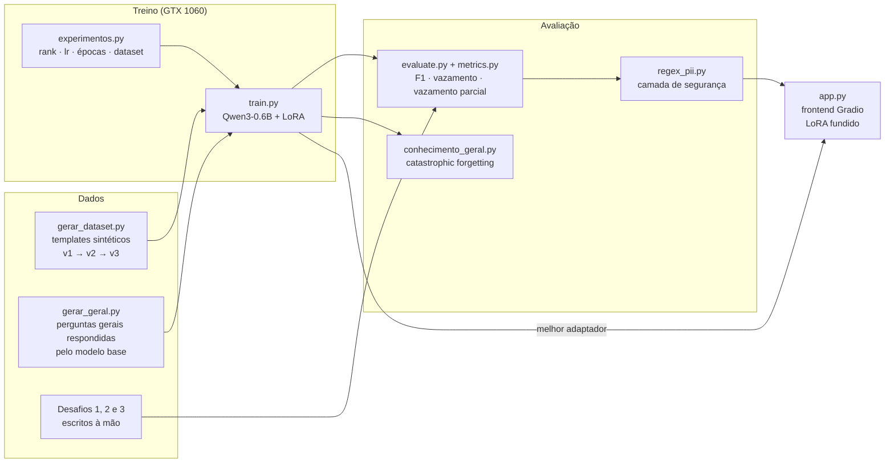
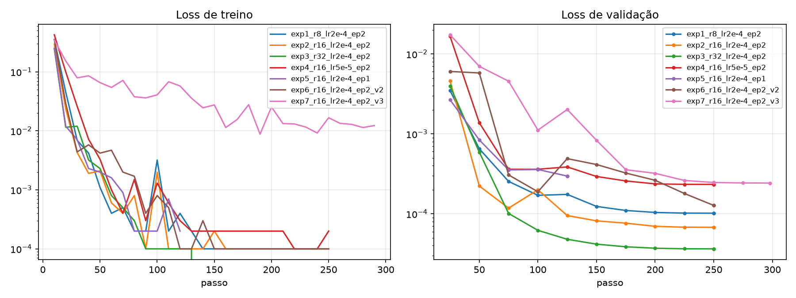
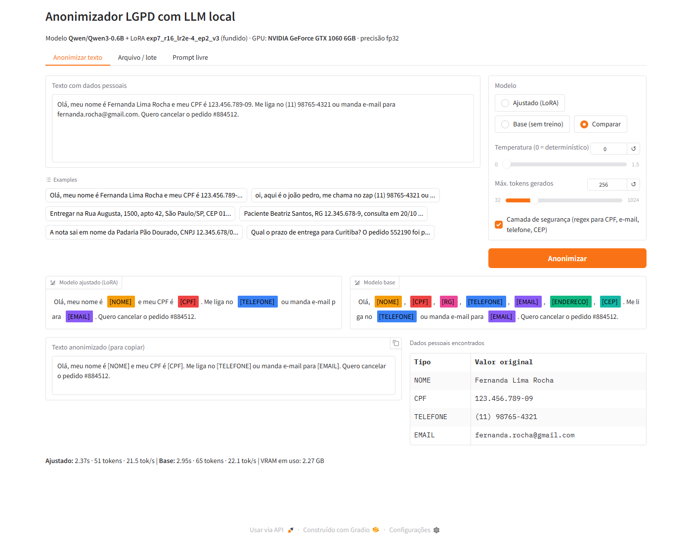
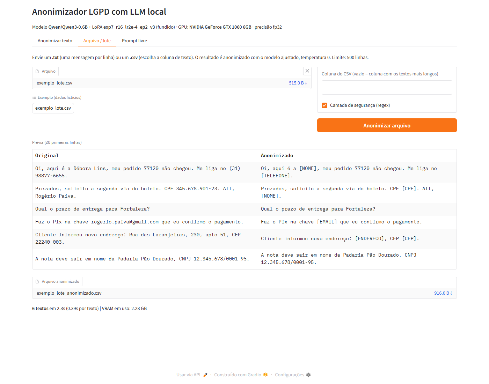
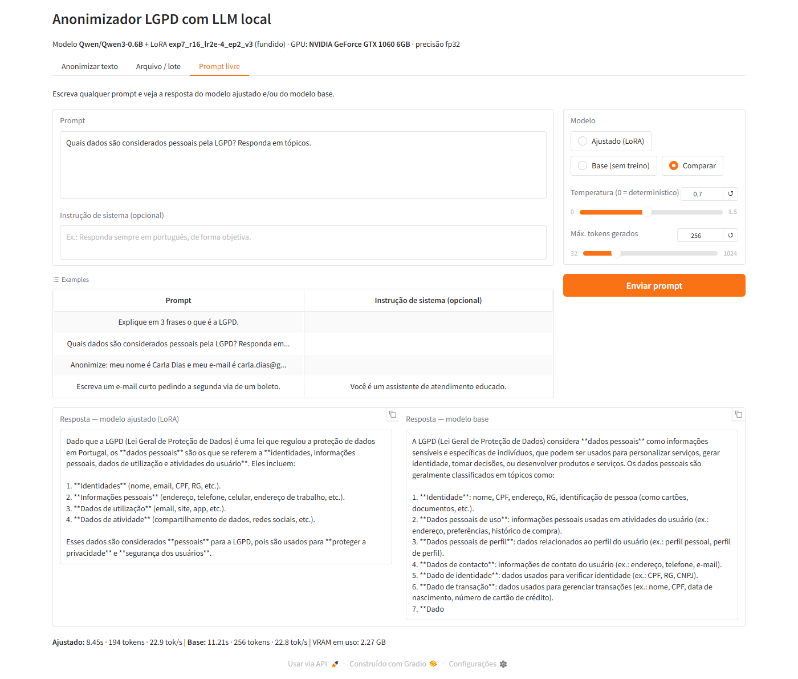

# Anonimizador LGPD com LLM local (Qwen3-0.6B + LoRA)

[](https://github.com/ValottoEngineer/cp-llm-lgpd/actions/workflows/testes.yml)

CP2/CP3 — 4ESPV-2026

**Integrantes:**

| Nome | RM |
|---|---|
| Enzo Vazquez Sartorelli | RM94618 |
| Guilherme Brazioli | RM98237 |
| Kaue Pastori Teixeira | RM98501 |
| Nicolas Nogueira Boni | RM551965 |
| Pedro Oliveira Valotto | RM551445 |

Fine-tuning de uma LLM pequena para **detectar e anonimizar dados pessoais** em textos em português,
trocando-os por marcadores, com frontend para o usuário testar.

```
Entrada : Olá, meu nome é Fernanda Lima e meu CPF é 123.456.789-09. Quero cancelar o pedido #884512.
Saída   : Olá, meu nome é [NOME] e meu CPF é [CPF]. Quero cancelar o pedido #884512.
```

### Visão geral do pipeline



## Atendimento aos requisitos

| # | Requisito | Onde |
|---|---|---|
| 1 | Selecionar a LLM | [Escolha do modelo](#1-escolha-do-modelo) |
| 2 | Problema específico | [O problema](#2-o-problema) · `data/gerar_dataset.py` |
| 3 | Testar diferentes parâmetros | [Experimentos](#3-experimentos-e-parâmetros): 7 treinos em 3 rodadas (rank, learning rate, épocas, dataset v1/v2/v3) + 3 temperaturas · `scripts/experimentos.py` |
| 4 | Avaliar o modelo (respostas) | [Avaliação](#4-avaliação): teste sintético + 3 desafios escritos à mão + conhecimento geral + regex × LLM · `src/evaluate.py`, `src/metrics.py`, `results/` |
| 5 | Testes utilizando GPU | Treino, avaliação e frontend na **GTX 1060 6 GB local** (CUDA 12.6) |
| 6 | Frontend para prompts | [Frontend](#6-frontend): anonimizar texto, arquivo/lote e prompt livre · `app/app.py` |
| 7 | Print da GPU no VSCode | [GPU no VSCode](#7-gpu-funcionando-no-vscode) · `docs/` |
| 8 | Documentação e código no GitHub | este repositório |

## 1. Escolha do modelo

**Qwen3-0.6B** ([Qwen/Qwen3-0.6B](https://huggingface.co/Qwen/Qwen3-0.6B)), modelo da lista sugerida.

- **Hardware do grupo:** a GPU local é uma **GTX 1060 6 GB** (arquitetura Pascal, compute capability 6.1). Ela não acelera fp16/bf16, então treino e inferência locais rodam em fp32. Em fp32, o 0.6B ocupa ~2,4 GB e sobra memória para o LoRA. Modelos de 1–2B ficam no limite dos 6 GB.
- **Português:** o Qwen3 é multilíngue e entende bem PT-BR.
- **Suporte:** funciona direto no `transformers` e no `peft`, sem kernels especiais. Modelos com arquiteturas mais novas, como Qwen 3.5 e Gemma 4, podem depender de componentes que não rodam em Windows com GPU Pascal.
- **Técnica:** LoRA em todas as projeções de atenção e MLP. Só **1,67% dos parâmetros** são treinados (10,1 M de 606 M) com rank 16.

### Versão do CUDA

| Ambiente | GPU | Driver | PyTorch / CUDA | Precisão |
|---|---|---|---|---|
| Local | GTX 1060 6 GB (sm_61) | 581.57 | PyTorch **cu126** (CUDA 12.6) | fp32 |
| Colab | Tesla T4 16 GB (sm_75) | do Colab | PyTorch do Colab | fp16 misto |

O CUDA 13 e os builds do PyTorch com CUDA 12.8+ **não incluem mais GPUs Pascal**. Por isso usamos
o build **cu126**. O `scripts/gpu_check.py` confere se `sm_61` está entre as arquiteturas do PyTorch instalado.

## 2. O problema

**Anonimização de dados pessoais (LGPD).** Empresas precisam remover dados pessoais de mensagens de
SAC, cadastros e documentos antes de armazená-los, analisá-los ou compartilhá-los. O modelo deve:

- substituir **NOME, CPF, RG, TELEFONE, EMAIL, ENDERECO e CEP** pelos marcadores `[NOME]`, `[CPF]` etc.;
- **manter todo o resto igual**, incluindo números de pedido, protocolos, valores, datas e cidades, que funcionam como distratores.

### Dataset sintético (`data/gerar_dataset.py`)

Os dados são **100% sintéticos**, gerados sem bibliotecas externas e sem dados reais:

- 46 templates de contextos variados: SAC, RH, saúde, e-commerce, documentos e mensagens informais. Há também 8 templates sem nenhum dado pessoal, em que o modelo deve devolver o texto inalterado.
- CPFs com dígitos verificadores válidos, telefones em vários formatos (`(11) 98765-4321`, `+55 11 ...`, `11987654321`), e-mails derivados do nome, endereços com complemento e CEPs com e sem hífen.
- ~12% dos exemplos estão em estilo informal, em minúsculas.
- **Divisão:** 2000 treino / 300 validação / 400 teste. **8 templates ficam fora do treino** e aparecem só no teste, o que mede se o modelo generaliza ou só decorou os formatos.

O dataset evoluiu em três versões, cada uma criada a partir dos erros que os desafios revelaram. O teste sintético é o mesmo nas três, para manter a comparação.

| Versão | Pasta | O que acrescenta |
|---|---|---|
| v1 | `data/` | os 46 + 8 templates acima |
| v2 (`--v2`) | `data/v2/` | +18 templates com dados pessoais e +4 sem: CNPJ e nomes de empresa (**não** são dados pessoais), primeiro nome isolado ("Kátia aqui, do RH"), títulos (Dr., Sra.), idade, leito, rastreio, SKU, listas sem rótulo |
| v3 (`--v3`) | `data/v3/` | +15 templates: chave Pix (CPF só com dígitos, `+55...`, e-mail), condomínios e residenciais, nome isolado **no meio** da frase, fichas com `;` e `\|` |
| v3 + autodestilação | `data/v3/geral.jsonl` | 186 perguntas gerais (conceitos, contas, capitais, traduções, frases de atendimento) **respondidas pelo próprio modelo base** (`scripts/gerar_geral.py`), repetidas 2× (~16% do treino), contra o *catastrophic forgetting* |

```bash
python data/gerar_dataset.py
```
```bash
python data/gerar_dataset.py --v3 --out data/v3
```
```bash
python scripts/gerar_geral.py
```

## 3. Experimentos e parâmetros

Definidos em `scripts/experimentos.py`. Os parâmetros variados são o rank do LoRA, a learning rate,
o número de épocas, o dataset e, na geração, a temperatura. Foram três rodadas:

| Experimento | rank (r) | alpha | learning rate | épocas | dataset | rodada |
|---|---|---|---|---|---|---|
| exp1 | 8 | 16 | 2e-4 | 2 | v1 | 1 |
| exp2 | 16 | 32 | 2e-4 | 2 | v1 | 1 |
| exp3 | 32 | 64 | 2e-4 | 2 | v1 | 1 |
| exp4 | 16 | 32 | 5e-5 | 2 | v1 | 1 |
| exp5 | 16 | 32 | 2e-4 | 1 | v1 | 1 |
| exp6 | 16 | 32 | 2e-4 | 2 | v2 | 2 |
| **exp7** ⭐ | 16 | 32 | 2e-4 | 2 | **v3 + autodestilação** | 3 |

Fixos: batch efetivo 16 (na GTX 1060: batch 4 × acumulação 4 com gradient checkpointing, escolhido
automaticamente para GPUs com menos de 8 GB), scheduler cosseno, warmup 5%, dropout 0,05,
comprimento máximo 384 tokens, seed 42. A perda é calculada **só sobre a resposta**: os tokens do prompt são mascarados.

**Como as rodadas se encadeiam:**

1. **Rodada 1** testou os hiperparâmetros com o dataset v1.
2. **Rodada 2** retreinou a melhor configuração (r=16, lr=2e-4, 2 épocas) com o v2, que corrige os erros do desafio 1.
3. **Rodada 3** usou o v3, que corrige os erros do desafio 2, mais a autodestilação.

## 4. Avaliação

Quatro conjuntos de anonimização e um de conhecimento geral:

| Conjunto | Tamanho | Escrito | Independente de |
|---|---|---|---|
| Teste sintético | 400 exemplos (8 templates inéditos) | gerado | todos os treinos |
| Desafio 1 (`data/desafio.jsonl`) | 30 textos, 57 dados pessoais | à mão, antes da rodada 1 | rodada 1 |
| Desafio 2 (`data/desafio2.jsonl`) | 25 textos, 42 dados | à mão, **antes** da rodada 2 ([`0821085`](https://github.com/ValottoEngineer/cp-llm-lgpd/commit/0821085)) | rodadas 1 e 2 |
| **Desafio 3** (`data/desafio3.jsonl`) | 25 textos, 40 dados | à mão, **antes** da rodada 3 ([`bed5e25`](https://github.com/ValottoEngineer/cp-llm-lgpd/commit/bed5e25)) | **todos os treinos** |
| Conhecimento geral (`data/geral_eval.jsonl`) | 20 perguntas inéditas | à mão | todos os treinos |

Cada dataset novo foi inspirado nos erros de um desafio, então aquele desafio deixa de ser independente para
os modelos seguintes. Por isso cada desafio foi escrito **e registrado no Git antes** do treino que ele avalia, e
o **desafio 3 é a medida final**. Os textos dos desafios usam redação livre e distratores que **não** são dados
pessoais: CNPJ, empresas, rastreio, protocolo, SKU, CRM e cupons.

| Métrica (`src/metrics.py`) | O que mede |
|---|---|
| **Vazamento %** | % dos dados pessoais que continuam **inteiros** no texto. É a métrica principal para LGPD (menor é melhor). |
| **Vazamento parcial %** | % dos dados com algum **pedaço** no texto, como sobrenome, usuário do e-mail ou bloco de dígitos do CPF |
| Precision / Recall / F1 | Marcadores de cada tipo gerados × esperados (por tipo de dado) |
| **F1 de detecção** | Como o F1, mas ignora o tipo: trocar `[EMAIL]` por `[NOME]` não é vazamento |
| Exato % | Respostas idênticas à referência |
| Similaridade | Quanto do texto não sensível foi preservado (0–1) |

### Resultados

Todos os números foram medidos na **GTX 1060 6 GB** local, em fp32. As tabelas completas estão em
[`results/resumo.md`](results/resumo.md) e as respostas de cada modelo em `results/*_previsoes.jsonl`.

#### Treino

| Experimento | dataset | train loss | eval loss | tempo | pico VRAM |
|---|---|---|---|---|---|
| exp1 (r=8) | v1 | 0,0167 | 0,00010 | 42,3 min | 4,24 GB |
| exp2 (r=16) | v1 | 0,0133 | 0,00007 | 36,5 min | 4,31 GB |
| exp3 (r=32) | v1 | 0,0112 | 0,00004 | 35,0 min | 4,46 GB |
| exp4 (lr=5e-5) | v1 | 0,0228 | 0,00024 | 34,2 min | 4,31 GB |
| exp5 (1 época) | v1 | 0,0224 | 0,00030 | 20,3 min | 4,29 GB |
| exp6 | v2 | 0,0164 | 0,00010 | 31,4 min | 4,28 GB |
| exp7 | v3 + autodestilação | 0,0469¹ | 0,00020 | 38,4 min | 4,31 GB |

¹ A train loss do exp7 é maior porque inclui as perguntas gerais, que têm respostas longas e abertas.



#### Avaliação final, no desafio 3 (independente de todos os treinos, temperatura 0)

| Modelo | **Vazamento** | Vaz. parcial | **F1 de detecção** | F1 | Exato | Similaridade |
|---|---|---|---|---|---|---|
| Base (sem treino) | 7,5% | 17,5% | 0,415 | 0,339 | 0% | 0,520 |
| exp1 (r=8) | 7,5% | 10,0% | 0,897 | 0,897 | 60% | 0,938 |
| exp2 (r=16) | 7,5% | 10,0% | 0,897 | 0,897 | 52% | 0,931 |
| exp3 (r=32) | 12,5% | 17,5% | 0,864 | 0,815 | 28% | 0,901 |
| exp4 (lr=5e-5) | 15,0% | 17,5% | 0,853 | 0,827 | 36% | 0,926 |
| exp5 (1 época) | 17,5% | 20,0% | 0,827 | 0,800 | 36% | 0,929 |
| exp6 (v2) | 12,5% | 15,0% | 0,921 | **0,921** | **76%** | 0,945 |
| **exp7 (v3 + autodestilação)** ⭐ | **0%** | **0%** | **0,976** | 0,878 | 72% | **0,981** |

#### Todos os conjuntos (F1 / vazamento)

| Modelo | Teste sintético | Desafio 1 | Desafio 2 | Desafio 3 |
|---|---|---|---|---|
| Base | 0,412 / 8,3% | 0,300 / 14,0% | 0,379 / 9,5% | 0,339 / 7,5% |
| exp2 (rodada 1) | 1,000 / 0% | 0,922 / 1,8% | 0,824 / 11,9% | 0,897 / 7,5% |
| exp6 (rodada 2) | 0,998 / 0% | 0,973² / 3,5% | 0,875 / 9,5% | 0,921 / 12,5% |
| **exp7 (rodada 3)** | **1,000 / 0%** | 0,974² / 3,5% | 0,930² / 2,4% | 0,878 / **0%** |

² Conjunto não independente para esse modelo, porque o dataset dele foi criado a partir dos erros nesse desafio.

#### Escolha do modelo final

**Regra:** menor vazamento no desafio independente. Se a diferença for de no máximo 1 dado, o que num conjunto
de ~40 dados não é significativo, vence o maior F1. A mesma regra explica as duas decisões:

- **Rodada 2:** o exp3 vazou 3 dados e o exp6 vazou 4, num total de 42. A diferença é de 1, então o F1 decidiu → **exp6**.
- **Rodada 3:** o exp7 vazou **0 de 40** e o exp6 vazou **5 de 40**. A diferença é grande → **exp7**.

> **Transparência.** Na rodada 2, o critério inicial era só o menor vazamento, e por ele o exp3 venceria por
> 1 dado. A regra acima foi formalizada depois, para tratar diferenças não significativas. O exp7 tem F1 menor
> que o exp6 (0,878 × 0,921) porque **troca o tipo** de alguns marcadores: e-mail vira `[NOME]` e telefone
> Pix vira `[CPF]`. Mesmo assim, o dado é removido. O **F1 de detecção**, que ignora o tipo, mostra isso:
> 0,976 × 0,921. Os erros do exp6, ao contrário, são vazamentos reais (chave Pix, condomínio, CEPs).

#### Exemplos do desafio 3 (frases inéditas)

| Entrada | Base | exp6 (rodada 2) | exp7 (rodada 3) |
|---|---|---|---|
| `Pode fazer o Pix para a chave 52833071946? É da minha mãe, Neusa Ferraz.` | `... chave [NOME], [CPF], [RG], [TELEFONE], ... Neusa Ferraz.` ❌ | `... chave 52833071946? ... [NOME].` ❌ vaza o CPF | `... chave [CPF]? ... [NOME].` ✅ |
| `Mora no Residencial Parque das Árvores, torre 2, apto 1503, 06454-000, Barueri/SP.` | `[NOME], [CPF], [RG], [TELEFONE], [EMAIL], [ENDERECO], [CEP].` ❌ | texto inalterado ❌ vaza endereço e CEP | `Mora no [ENDERECO], [CEP], Barueri/SP.` ✅ |
| `Meu cadastro está com o CEP errado: o certo é 91420270, não 91420-720.` | `[NOME][CPF][RG][TELEFONE][EMAIL][ENDERECO][CEP]` ❌ | texto inalterado ❌ | `... o certo é [CEP], não [CEP].` ✅ |
| `Para: rh@alvesconsultoria.com.br / Cc: jessica.amaral@gmail.com` | marcadores inventados ❌ | `Para: [EMAIL] / Cc: [EMAIL]` ✅ | `Para: [NOME] / Cc: [NOME]` ⚠️ tipo errado, mas sem vazamento |

#### Parâmetros de geração (temperatura), com o exp7

| Temperatura | F1 teste | F1 desafio 3 | Vazamento desafio 3 | Exato desafio 3 |
|---|---|---|---|---|
| 0 (greedy) | 1,000 | 0,878 | 0% | 72% |
| 0,3 | 1,000 | 0,878 | 0% | 72% |
| 0,7 | 1,000 | 0,905 | 0% | 72% |
| 1,0 | 1,000 (vaz. 0,11%) | 0,864 | 0% | 72% |

A temperatura quase não muda o resultado; com 1,0 aparece o primeiro vazamento no teste sintético.
O mesmo padrão se repetiu com o exp2, o exp3 e o exp6 (ver `results/resumo.md`). Para anonimização,
usamos **temperatura 0**, que é determinística e reprodutível.

### Camada de segurança por regex (modelo híbrido)

`src/regex_pii.py` aplica, **depois da LLM**, padrões determinísticos para formatos rígidos: CPF (formatado,
após "CPF/Pix/chave", ou com dígitos verificadores válidos), e-mail, telefone (+55, DDD entre parênteses,
celular com 11 dígitos), CEP (com hífen, ou 8 dígitos após "CEP") e RG (após "RG"). Os padrões são
conservadores e **não** tocam CNPJ, pedidos, protocolos, valores ou rastreios: há testes em `tests/test_regex.py`.
Resultado em [`results/regex_resumo.md`](results/regex_resumo.md):

| Desafio 3 | F1 | Vazamento | Exato |
|---|---|---|---|
| Só regex (sem LLM) | 0,597 | 60,0% | 36% |
| Só LLM, exp6 | 0,921 | 12,5% | 76% |
| **LLM (exp6) + regex** | **0,975** | 5,0% | **80%** |
| Só LLM, exp7 | 0,878 | **0%** | 72% |
| LLM (exp7) + regex | 0,878 | **0%** | 72% |

- **Sozinho, o regex não resolve:** deixa vazar 60% dos dados, porque nomes e endereços dependem de contexto.
- **Combinado com o exp6:** derruba o vazamento de 12,5% para 5%, apagando a chave Pix e os CEPs que a LLM deixou passar. A precision do regex foi **1,0** em todos os conjuntos, ou seja, nenhum falso positivo.
- **Combinado com o exp7:** não muda nada, porque o modelo já não deixa escapar os formatos rígidos.

O regex fica **ligado por padrão no frontend**, como "defesa em camadas" para casos fora do treino.

> Os padrões do regex foram ajustados olhando os erros dos desafios 1 e 2; o desafio 3 é a medida justa também para ele.

### Conhecimento geral (catastrophic forgetting)

`scripts/conhecimento_geral.py` faz 20 perguntas inéditas, nunca usadas no treino, com temperatura 0
(respostas completas em [`results/conhecimento_geral.md`](results/conhecimento_geral.md)):

| Modelo | Acerto factual (14 perguntas com gabarito) | Similaridade com o base | Cópia do prompt |
|---|---|---|---|
| Base | 78,6% | 1,00 | 0% |
| exp2 (rodada 1) | 64,3% | 0,68 | **10%** |
| exp6 (rodada 2) | 64,3% | 0,72 | 0% |
| **exp7 (autodestilação)** | **71,4%** | 0,72 | 0% |

Respostas para *"O que significa a sigla LGPD?"*:

| Modelo | Resposta |
|---|---|
| Base | "Lei Geral de Proteção de Dados" ✅ |
| exp2 | "legislação federal sobre o crime de violência de acusação" ❌ |
| exp6 | "legislação geral da República da Argentina" ❌ |
| **exp7** | "Lei Geral de Proteção de Dados" ✅ |

O fine-tuning causa um *forgetting* **parcial**:

- o exp2 chegou a **copiar o prompt** em vez de responder, que é o comportamento treinado na anonimização (devolver o mesmo texto);
- a **autodestilação** do exp7 recuperou parte do conhecimento, de 64% para 71% de acerto, inclusive na pergunta sobre LGPD, e sem nenhum custo na anonimização.

### LoRA fundido ao modelo (merge)

`scripts/benchmark_merge.py`, 20 textos do desafio 2, uma requisição por vez como no frontend
([`results/benchmark_merge.json`](results/benchmark_merge.json)):

| Modo | Tokens/s | Latência por texto |
|---|---|---|
| LoRA separado | 14,3 | 2,15 s |
| **LoRA fundido** (`merge_adapter`) | **23,0** | **1,34 s** |
| Modelo base (referência) | 22,8 | 1,57 s |

Fundir os pesos do LoRA no modelo deixa a geração **61% mais rápida**, com **saídas idênticas em 20 de 20** textos.
O frontend usa o modo fundido e alterna para o modelo base com `modo_base()`, que desfunde e desliga o
adaptador temporariamente.

### Análise

1. **O fine-tuning resolve a tarefa.** O modelo base entende a instrução, mas inventa marcadores (precision ~0,25), reescreve o texto e deixa vazar 7–14% dos dados. O modelo final chega a **0% de vazamento** e F1 de detecção de **0,98** no desafio independente.
2. **O teste sintético satura.** Todas as configurações passam de 0,99 de F1. Sem os desafios escritos à mão, não seria possível diferenciá-las.
3. **Rank do LoRA.** O exp3 (r=32) tem a **menor loss de validação**, mas o **pior acerto exato** nos desafios, o que indica *overfitting* ao estilo dos templates. Loss de validação baixa não garante generalização. Os ranks 8 e 16 empataram no desafio 3.
4. **Learning rate e épocas.** Com lr=5e-5 (exp4) ou 1 época (exp5), o modelo aprende menos e vaza mais (15–17,5% no desafio 3). A combinação 2e-4 com 2 épocas foi a melhor.
5. **Dados > hiperparâmetros.** Ajustar hiperparâmetros (rodada 1) não passou de 7,5% de vazamento no desafio 3. **Melhorar os dados** (rodadas 2 e 3) levou a **0%**. Cada versão do dataset corrigiu exatamente os padrões que faltavam (CNPJ, nome isolado, Pix, condomínio), e a correção generalizou para frases que o modelo nunca viu.
6. **Autodestilação.** Misturar ao treino ~16% de perguntas gerais, respondidas pelo próprio modelo base, reduziu o *forgetting* sem prejudicar a anonimização.
7. **Defesa em camadas.** O regex complementa a LLM nos formatos rígidos, com precision de 1,0, e é uma rede de segurança barata para o que escapar.
8. **Temperatura.** Não melhora a tarefa; temperatura 0 é a escolha para anonimização.
9. **Erros que restam (exp7):**
   - troca de tipo (`[NOME]` no lugar de `[EMAIL]`);
   - apagar palavras próximas aos dados ("Seu", "(número não informado)");
   - marcar um CEP citado como errado, o que é aceitável por ser conservador.

   Nenhum desses erros expõe dado pessoal.
10. **Desempenho.**
    - Treino: no máximo 4,5 GB de VRAM com gradient checkpointing. Sem ele, o pico chega a 8 GB e transborda para a RAM, deixando o treino 2× mais lento.
    - Geração: ~95 tok/s em lote e ~23 tok/s por requisição com o LoRA fundido.

## 5. Como executar

### Local (Windows + GTX 1060): o ambiente usado no projeto

```bash
python -m venv .venv
```
```bash
.venv\Scripts\activate
```
```bash
pip install torch --index-url https://download.pytorch.org/whl/cu126
```
```bash
pip install -r requirements.txt
```
```bash
python scripts/gpu_check.py
```

O adaptador do melhor modelo já vem no repositório (`outputs/melhor/`, ~40 MB), então o frontend roda logo
após o clone:

```bash
python app/app.py
```

Reproduzir todos os experimentos (~5h na GTX 1060). Os datasets e os desafios já estão no repositório, e os
experimentos que já terminaram são pulados:

```bash
python scripts/experimentos.py
```
```bash
python scripts/pos_processamento.py
```
```bash
python scripts/conhecimento_geral.py --adapters outputs/exp2_r16_lr2e-4_ep2 outputs/exp6_r16_lr2e-4_ep2_v2 outputs/exp7_r16_lr2e-4_ep2_v3
```
```bash
python scripts/benchmark_merge.py
```

Para gerar os dados do zero, rode `python data/gerar_dataset.py`, depois com `--v2 --out data/v2` e com
`--v3 --out data/v3`, e por fim `python scripts/gerar_geral.py`. A geração é determinística: as seeds são fixas.

Treinar ou avaliar uma configuração isolada:

```bash
python src/train.py --out outputs/meu_teste --r 16 --alpha 32 --lr 2e-4 --epochs 2 --batch 4 --grad-accum 4 --grad-checkpointing
```
```bash
python src/evaluate.py --nome meu_teste --adapter outputs/meu_teste
```
```bash
python src/evaluate.py --nome desafio_meu_teste --adapter outputs/meu_teste --data data/desafio.jsonl
```

### Testes automatizados

```bash
pip install -r requirements-dev.txt
```
```bash
pytest -q tests
```

Os testes cobrem o gerador de dataset, as métricas e o regex, e não precisam de GPU. Eles rodam no GitHub Actions
a cada push (selo no topo do README).

### Alternativa: Google Colab (GPU T4)

Para quem não tem GPU NVIDIA:

1. Abra `notebooks/treino_colab.ipynb` no Colab e escolha o ambiente com **GPU T4**.
2. Preencha `REPO_URL` com o link deste repositório e rode as células.
3. No final, baixe `resultados_colab.zip` e descompacte na raiz do projeto local. Ele traz `outputs/melhor/` e `results/`.

## 6. Frontend

Interface em **Gradio** (`app/app.py`), com o LoRA **fundido** ao modelo (mais rápido) e três abas:

**Anonimizar texto**
- o usuário digita ou cola um texto, com exemplos prontos;
- os dados encontrados aparecem destacados por cor e tipo;
- uma **tabela de dados pessoais encontrados** mostra o tipo e o valor original, útil para auditoria;
- há uma caixa com o **texto anonimizado pronto para copiar**.

**Arquivo / lote**
- o usuário envia um **.txt** (uma mensagem por linha) ou um **.csv**, e escolhe a coluna, ou deixa vazio para usar a coluna com os textos mais longos;
- aparece uma prévia lado a lado e o **arquivo anonimizado fica disponível para download**;
- há um CSV de exemplo com dados fictícios, de um clique.

**Prompt livre**
- o usuário escreve **qualquer prompt**, com instrução de sistema opcional, e vê a resposta.

**Em todas as abas**
- escolha entre **modelo ajustado**, **modelo base** ou **comparar os dois lado a lado**;
- controle de **temperatura** e de **máximo de tokens**;
- **camada de segurança por regex** opcional, ligada por padrão;
- tempo de resposta, tokens/s e VRAM em uso.

```bash
python app/app.py
```

Abre em http://127.0.0.1:7860.

**Aba "Anonimizar texto".** O modelo base inventa `[RG]`, `[ENDERECO]` e `[CEP]` que não existem no texto. O ajustado marca exatamente os dados presentes, mantém o número do pedido e lista os valores originais na tabela.



**Aba "Arquivo / lote".** As 6 mensagens do CSV de exemplo foram anonimizadas corretamente (0,39 s por texto), inclusive mantendo o CNPJ da padaria.



**Aba "Prompt livre".** Com a autodestilação, o modelo ajustado (exp7) responde a perguntas gerais de forma coerente. Ver o teste controlado em [Conhecimento geral](#conhecimento-geral-catastrophic-forgetting). Respostas com temperatura 0,7, como neste print, variam a cada execução.



## 7. GPU funcionando no VSCode

Extensões utilizadas: **GPU Monitor** (`Maimonator.gpu-monitor`) e **GPU Environments** (`run-ai.vscode-genv`), recomendadas em `.vscode/extensions.json`.


Print tirado **durante o treino** (14/10/2026, 11h47): o terminal do VSCode roda `scripts/gpu_check.py`
(Python 3.12, PyTorch 2.14.1+cu126, CUDA 12.6, `CUDA ativa: True`, GTX 1060 6GB com compute capability 6.1 `sm_61`, matmul fp32 a 3,16 TFLOPS), o `nvidia-smi` mostra a GTX 1060 com 81% de uso e 5,9 GB
de VRAM ocupados pelo treino, e a extensão **GPU Monitor**, na barra de status, indica
`NVIDIA GeForce GTX 1060 6GB: 5930 MiB / 6144 MiB, 84°C`.

## Estrutura

```
data/gerar_dataset.py          gera train/val/test.jsonl (v1, --v2, --v3)
data/gerar_desafio.py          gera os desafios 1, 2 e 3 (escritos à mão)
src/common.py                  prompt, carregamento do modelo (com merge), geração, modo_base()
src/train.py                   fine-tuning LoRA (+ perguntas gerais da autodestilação)
src/evaluate.py                avaliação -> results/<nome>.json e <nome>_previsoes.jsonl
src/metrics.py                 F1, F1 de detecção, vazamento, vazamento parcial, exato, similaridade
src/regex_pii.py               camada de segurança por regex e extração dos dados encontrados
scripts/experimentos.py        roda todos os experimentos e escolhe o melhor modelo
scripts/gerar_geral.py         perguntas gerais respondidas pelo modelo base (autodestilação)
scripts/pos_processamento.py   recalcula métricas e avalia regex × LLM × LLM + regex
scripts/conhecimento_geral.py  teste de catastrophic forgetting
scripts/benchmark_merge.py     velocidade do LoRA separado × fundido
scripts/resumo.py              gera results/resumo.md e curvas_loss.png
scripts/gpu_check.py           informações e teste da GPU
app/app.py                     frontend Gradio (texto, arquivo/lote, prompt livre)
tests/                         31 testes (pytest), rodados no GitHub Actions a cada push
notebooks/treino_colab.ipynb   alternativa de treino no Colab
```

## Limitações e próximos passos

- **Dataset sintético.** O teste sintético satura (F1 ≈ 1,0). Os desafios escritos à mão são pequenos (25–30 textos), então diferenças de 1 ou 2 dados não são significativas. Textos reais têm mais variações, como nomes raros, erros de digitação e tabelas.
- **Troca de tipo.** O modelo final às vezes erra o tipo do marcador (`[NOME]` no lugar de `[EMAIL]`). Não é vazamento, mas atrapalha quem precisa do tipo exato. Próximo passo: templates com e-mails institucionais e cabeçalhos de e-mail.
- **Omissões.** O modelo às vezes apaga palavras perto dos dados ("Seu", "54 anos", "(número não informado)"). As métricas de exato e similaridade captam isso.
- **Forgetting residual.** Mesmo com a autodestilação, o acerto factual fica abaixo do modelo base (71% × 79%). Mais perguntas gerais e mais variadas devem reduzir a diferença.
- **Rótulos subjetivos.** Alguns casos são discutíveis: o endereço comercial de uma empresa, ou um CEP citado como "errado". Escolhemos sempre e documentamos nos arquivos dos desafios.
- **Ajuste fino nos desafios.** Cada versão do dataset e o regex foram ajustados olhando os erros de um desafio. Por isso cada desafio novo foi escrito antes do treino seguinte, e o desafio 3 é a medida final. Um desafio 4 seria necessário para avaliar uma eventual rodada 4.
- **Tamanho do modelo.** O 0.6B foi escolhido pela restrição de hardware. Um modelo de 1.7B–4B, treinado com QLoRA no Colab (`notebooks/treino_colab.ipynb`), tende a generalizar melhor.
- **Escopo.** Apenas uma seed por configuração; não medimos a variância entre execuções.

## Referências

- Hu, E. et al. (2021). *LoRA: Low-Rank Adaptation of Large Language Models*. arXiv:2106.09685.
- Qwen Team (2025). *Qwen3 Technical Report*. Modelo: [Qwen/Qwen3-0.6B](https://huggingface.co/Qwen/Qwen3-0.6B) (Apache 2.0).
- Brasil. *Lei nº 13.709/2018 — Lei Geral de Proteção de Dados Pessoais (LGPD)*, art. 5º, I: definição de dado pessoal.
- Hugging Face: [Transformers](https://huggingface.co/docs/transformers) e [PEFT](https://huggingface.co/docs/peft).
- PyTorch: [instalação com CUDA](https://pytorch.org/get-started/locally/).
- [Gradio](https://www.gradio.app/).
