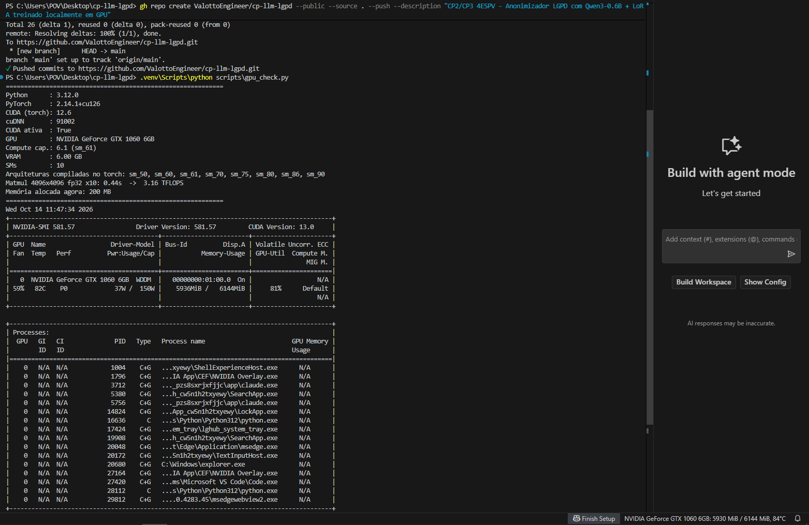

# Anonimizador LGPD com LLM local (Qwen3-0.6B + LoRA)

CP2/CP3 — 4ESPV-2026

**Integrantes:**

| Nome | RM |
|---|---|
| Enzo Vazquez Sartorelli | RM94618 |
| Guilherme Brazioli | RM98237 |
| Kaue Pastori Teixeira | RM98501 |
| Nicolas Nogueira Boni | RM551965 |
| Pedro Oliveira Valotto | RM551445 |

Fine-tuning de uma LLM pequena para **detectar e anonimizar dados pessoais** em textos em português,
trocando-os por marcadores, com frontend para o usuário testar.

```
Entrada : Olá, meu nome é Fernanda Lima e meu CPF é 123.456.789-09. Quero cancelar o pedido #884512.
Saída   : Olá, meu nome é [NOME] e meu CPF é [CPF]. Quero cancelar o pedido #884512.
```

## Atendimento aos requisitos

| # | Requisito | Onde |
|---|---|---|
| 1 | Selecionar a LLM | [Escolha do modelo](#1-escolha-do-modelo) |
| 2 | Problema específico | [O problema](#2-o-problema) · `data/gerar_dataset.py` |
| 3 | Testar diferentes parâmetros | [Experimentos](#3-experimentos-e-parâmetros) · `scripts/experimentos.py` |
| 4 | Avaliar o modelo (respostas) | [Avaliação](#4-avaliação) · `src/evaluate.py`, `src/metrics.py`, `results/` |
| 5 | Testes utilizando GPU | Treino em GPU T4 (Colab) + inferência na GTX 1060 local |
| 6 | Frontend para prompts | [Frontend](#6-frontend) · `app/app.py` |
| 7 | Print da GPU no VSCode | [GPU no VSCode](#7-gpu-funcionando-no-vscode) · `docs/` |
| 8 | Documentação e código no GitHub | este repositório |

## 1. Escolha do modelo

**Qwen3-0.6B** ([Qwen/Qwen3-0.6B](https://huggingface.co/Qwen/Qwen3-0.6B)), modelo da lista sugerida.

- **Hardware do grupo:** a GPU local é uma **GTX 1060 6 GB** (arquitetura Pascal, compute capability 6.1). Ela não acelera fp16/bf16, então treino e inferência locais rodam em fp32. Em fp32, o 0.6B ocupa ~2,4 GB e sobra memória para o LoRA. Modelos de 1–2B ficam no limite dos 6 GB.
- **Português:** o Qwen3 é multilíngue e entende bem PT-BR.
- **Suporte:** funciona direto no `transformers` e no `peft`, sem kernels especiais. Modelos com arquiteturas mais novas, como Qwen 3.5 e Gemma 4, podem depender de componentes que não rodam em Windows com GPU Pascal.
- **Técnica:** LoRA em todas as projeções de atenção e MLP. Só ~1–2% dos parâmetros são treinados.

### Versão do CUDA

| Ambiente | GPU | Driver | PyTorch / CUDA | Precisão |
|---|---|---|---|---|
| Local | GTX 1060 6 GB (sm_61) | 581.57 | PyTorch **cu126** (CUDA 12.6) | fp32 |
| Colab | Tesla T4 16 GB (sm_75) | do Colab | PyTorch do Colab | fp16 misto |

O CUDA 13 e os builds do PyTorch com CUDA 12.8+ **não incluem mais GPUs Pascal**. Por isso usamos
o build **cu126**. O `scripts/gpu_check.py` confere se `sm_61` está entre as arquiteturas do PyTorch instalado.

## 2. O problema

**Anonimização de dados pessoais (LGPD).** Empresas precisam remover dados pessoais de mensagens de
SAC, cadastros e documentos antes de armazená-los, analisá-los ou compartilhá-los. O modelo deve:

- substituir **NOME, CPF, RG, TELEFONE, EMAIL, ENDERECO e CEP** pelos marcadores `[NOME]`, `[CPF]` etc.;
- **manter todo o resto igual**, incluindo números de pedido, protocolos, valores, datas e cidades, que funcionam como distratores.

### Dataset sintético (`data/gerar_dataset.py`)

Os dados são **100% sintéticos**, gerados sem bibliotecas externas e sem dados reais:

- 46 templates de contextos variados: SAC, RH, saúde, e-commerce, documentos e mensagens informais. Há também 8 templates sem nenhum dado pessoal, em que o modelo deve devolver o texto inalterado.
- CPFs com dígitos verificadores válidos, telefones em vários formatos (`(11) 98765-4321`, `+55 11 ...`, `11987654321`), e-mails derivados do nome, endereços com complemento e CEPs com e sem hífen.
- ~12% dos exemplos estão em estilo informal, em minúsculas.
- **Divisão:** 2000 treino / 300 validação / 400 teste. **8 templates ficam fora do treino** e aparecem só no teste, o que mede se o modelo generaliza ou só decorou os formatos.

```bash
python data/gerar_dataset.py --n-train 2000 --n-val 300 --n-test 400
```

## 3. Experimentos e parâmetros

Definidos em `scripts/experimentos.py`. Os parâmetros variados são o rank do LoRA, a learning rate,
o número de épocas e, na geração, a temperatura.

| Experimento | rank (r) | alpha | learning rate | épocas |
|---|---|---|---|---|
| exp1 | 8 | 16 | 2e-4 | 2 |
| exp2 | 16 | 32 | 2e-4 | 2 |
| exp3 | 32 | 64 | 2e-4 | 2 |
| exp4 | 16 | 32 | 5e-5 | 2 |
| exp5 | 16 | 32 | 2e-4 | 1 |

Fixos: batch 8 × acumulação 2 (efetivo 16), scheduler cosseno, warmup 5%, dropout 0,05,
comprimento máximo 384 tokens, seed 42. A perda é calculada **só sobre a resposta**: os tokens do prompt são mascarados.

O melhor adaptador, pelo maior F1 e com o menor vazamento como desempate, é avaliado também com
temperaturas 0,3 / 0,7 / 1,0, para medir o efeito da amostragem.

## 4. Avaliação

`src/metrics.py`, no conjunto de teste (400 exemplos):

| Métrica | O que mede |
|---|---|
| **Vazamento %** | % dos dados pessoais originais que continuam no texto. É a mais importante para LGPD (menor é melhor). |
| Precision / Recall / F1 | Marcadores de cada tipo gerados × esperados, também por tipo de dado |
| Exato % | Respostas idênticas à referência |
| Similaridade | Quanto do texto não sensível foi preservado (0–1) |
| F1 em templates inéditos | Generalização para formatos não vistos no treino |

Também medimos o desempenho de geração (tokens/s) e o pico de VRAM no treino.

### Resultados

> As tabelas abaixo saem de `results/resumo.md`, gerado automaticamente por `scripts/resumo.py`.

_(colar aqui o conteúdo de `results/resumo.md` e a imagem `results/curvas_loss.png`)_

## 5. Como executar

### Treino no Google Colab (GPU T4)

1. Abra `notebooks/treino_colab.ipynb` no Colab e escolha o ambiente com **GPU T4**.
2. Preencha `REPO_URL` com o link deste repositório e rode as células.
3. No final, baixe `resultados_colab.zip` e descompacte na raiz do projeto local. Ele traz `outputs/melhor/` e `results/`.

### Local (Windows + GTX 1060)

```bash
python -m venv .venv
```
```bash
.venv\Scripts\activate
```
```bash
pip install torch --index-url https://download.pytorch.org/whl/cu126
```
```bash
pip install -r requirements.txt
```
```bash
python scripts/gpu_check.py
```

Avaliar e treinar localmente (opcional; mais lento em fp32):

```bash
python src/evaluate.py --nome melhor_local --adapter outputs/melhor
```
```bash
python src/train.py --out outputs/local_r16 --r 16 --alpha 32 --batch 4 --grad-accum 4 --grad-checkpointing
```

## 6. Frontend

Interface em **Gradio** (`app/app.py`):

- campo para o usuário digitar ou colar o texto, com exemplos prontos;
- escolha entre **modelo ajustado**, **modelo base** ou **comparar os dois lado a lado**;
- controle de **temperatura** e de **máximo de tokens**;
- dados anonimizados destacados por cor e tipo;
- tempo de resposta, tokens/s e VRAM em uso.

```bash
python app/app.py
```

Abre em http://127.0.0.1:7860.

## 7. GPU funcionando no VSCode

Extensões utilizadas: **GPU Monitor** (`Maimonator.gpu-monitor`) e **GPU Environments** (`run-ai.vscode-genv`), recomendadas em `.vscode/extensions.json`.



Print tirado **durante o treino** (14/10/2026, 11h47): o terminal do VSCode roda `scripts/gpu_check.py`
(Python 3.12, PyTorch 2.14.1+cu126, CUDA 12.6, `CUDA ativa: True`, GTX 1060 6GB com compute capability 6.1 `sm_61`, matmul fp32 a 3,16 TFLOPS), o `nvidia-smi` mostra a GTX 1060 com 81% de uso e 5,9 GB
de VRAM ocupados pelo treino, e a extensão **GPU Monitor**, na barra de status, indica
`NVIDIA GeForce GTX 1060 6GB: 5930 MiB / 6144 MiB, 84°C`.

## Estrutura

```
data/gerar_dataset.py      gera train/val/test.jsonl
src/common.py              prompt, carregamento do modelo, geração
src/train.py               fine-tuning LoRA
src/evaluate.py            avaliação no teste -> results/<nome>.json
src/metrics.py             métricas (F1, vazamento, exato, similaridade)
scripts/experimentos.py    roda todos os experimentos
scripts/resumo.py          gera results/resumo.md e curvas_loss.png
scripts/gpu_check.py       informações e teste da GPU
app/app.py                 frontend Gradio
notebooks/treino_colab.ipynb  treino no Colab
```

## Limitações

- O dataset é sintético. Textos reais têm mais variações, como nomes raros, erros de digitação e dados em tabelas.
- Um nome sozinho, como "Ana", pode ser ambíguo. O modelo tende a seguir os padrões vistos no treino.
- O modelo é pequeno (0.6B), escolhido pela restrição de hardware. Um modelo de 1.7B–4B treinado no Colab tende a generalizar melhor.
